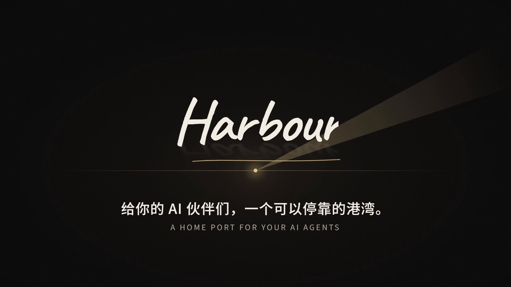
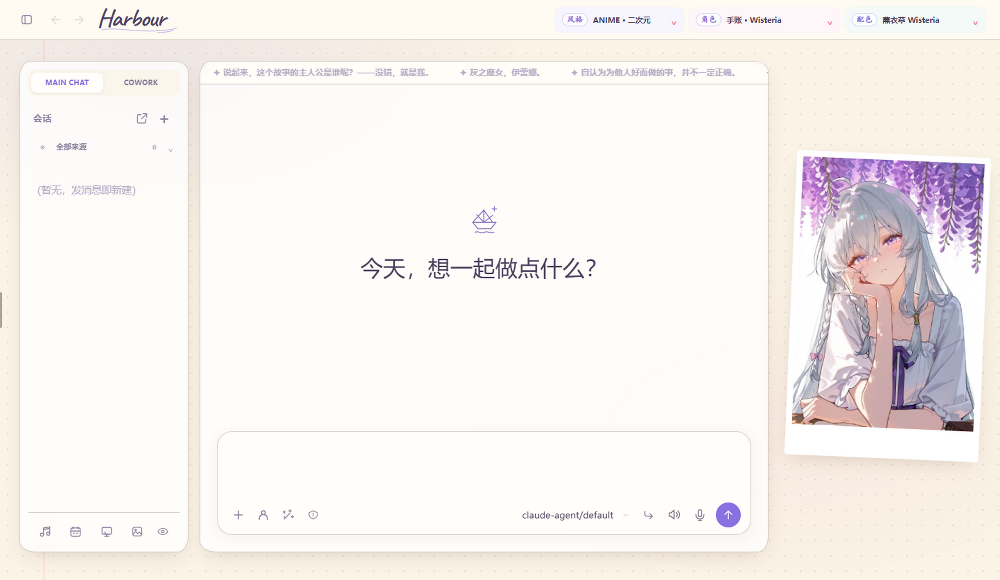
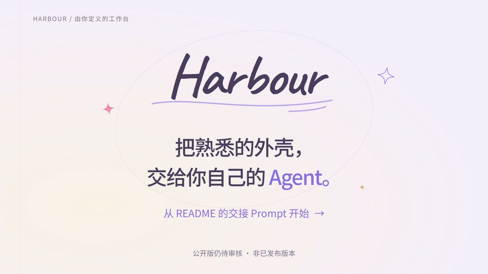

# Harbour

[](docs/media/harbour-story.mp4)

▶ **[观看介绍片](docs/media/harbour-story.mp4)**（39 秒 · 1080p · 有声，中英双语） · [关键帧](docs/media/harbour-story-contact-sheet.png) · [制作记录](demo/STORY-NOTES.md)

可自行配置角色、模型与工具的本地 Agent 工作台。

这个公开分支保留原 Harbour 的 **Electron 界面、Web 面板、主题、聊天布局和开屏动画**，只剥离个人数据与私人能力包，不是另一个精简客户端。

> 当前处于脱敏验收阶段，尚未把本次恢复推送到公开仓库。离线预览不会调用付费模型。



## 让你的 Agent 帮你装好

不用自己研究一堆配置。**复制下面这一行，发给有本地文件和终端能力的编码 Agent**（例如 Codex、Claude Code）。它会先阅读仓库里的交接说明，保留原界面、启动演示，再帮你接入自己的模型和助手。

```text
请帮我部署 Harbour 外壳：https://github.com/DemonRain7/harbour-lite 。先读取仓库的 AGENTS.md、README.md 和 docs/AGENT-SETUP.md，按交接说明在独立目录安装，保留原 Electron/Web 界面与开屏动画，不重写 UI、不覆盖我已有的 Harbour 或配置；先验证演示模式，再让我选择自己的模型和 Agent，密钥只在本机配置，不能发进聊天或提交 Git。交接文件不存在时请停止并说明版本不匹配，不要按旧版猜着安装。
```

[查看完整的 Agent 交接 Prompt →](docs/AGENT-SETUP.md) · [自行安装 ↓](#启动)

这是交给 Agent 的任务说明，不是需要粘贴到终端执行的命令。普通网页聊天若没有本地工具，只能指导你操作，不能替你安装。当前恢复版尚未推送；上面加入了版本检查，远端旧版不会被误当成当前版本安装。本地验收时把仓库地址替换为当前副本路径即可。

## 30 秒短版

[](docs/media/intro-harbour.mp4)

这版由隔离的 **Harbour 运行实例调用 GPT-6 Astra（Max）并加载 Remotion Skill** 制作，包含真实公开版界面截图与 Agent 安装交接入口。30 秒 / 1080p / 静音；视频不是产品功能验收或云服务接通证明。[下载 MP4](docs/media/intro-harbour.mp4) · [六张关键帧](docs/media/intro-harbour-contact-sheet.png) · [制作记录、源码与复现](demo/VIDEO-NOTES.md)

## 启动

建议 Node.js 24+；仅核心 Web / Electron 的最低要求为 Node.js 22.12。音乐子项目 Folia 及完整公开版回归需要 Node.js 24+。先在独立目录取得本仓库，再执行：

```powershell
npm ci
if (!(Test-Path .env)) { Copy-Item .env.example .env }
npm run serve
```

浏览器打开 `http://127.0.0.1:7799/`。初始 `MOCK_LLM=true` 只显示明确标注的演示回答，不是假装接通真实模型。

桌面端另装依赖：

```powershell
npm --prefix desktop ci
npm run desktop
```

公开版使用独立的数据目录、应用标识和端口；不自动迁移旧 Harbour 的数据。

## 配置自己的助手

在 `agents/<名称>/CLAUDE.md` 写 frontmatter 与角色规则，或从 Agent 页面编辑。默认只有无私人设定的 `main-assistant`。模型、语音、日历、Skill / Workflow / MCP 的配置界面仍使用原实现，由用户自行连接。

密钥只保存在本机 `.env`；聊天、上传、运行记录与模型配置不入 Git。公开服务需要认证及安全的反向代理，不应裸露管理端口。

## 界面与开屏

原来的手账、星光和放映室配色、字体、图标、侧栏、聊天框、设置页均保留。开屏继续使用原动画。展示图片与角色提示词分离，替换展示图片不会导入原用户的人设、记忆或偏好。

将 `desktop/startup.config.example.json` 复制为 `desktop/startup.config.json`，修改左右两侧的 `file`（PNG / JPEG / WebP，本机路径或相对配置文件的路径）和 `label`。某一侧设为 `false` 即隐藏。图片缺失时保留默认图，不阻塞启动；配置文件不会提交。重启公开版桌面端生效。聊天背景和立绘仍可用原界面的「聊天外观」上传更换。

## 脱敏范围

- 不复制原 `.env`、data、会话、Trace、上传、报表、全局记忆和 Git 历史。
- 不复制私人 Agent、人设、主人档案、偏好、定时任务和 Skill / Workflow 资料包。
- 保留通用代码、主题样式、字体与图标；模型、音乐和本机下载的资源不随仓库附送。
- 保留的角色装饰图只用于展示；不代表附带角色人设、音色或 Live2D 模型授权。

本次恢复中的代码与素材仍需完成发布清单及第三方授权检查，暂不把旧 Lite 版的发布包当作本版安装包。

## 本地检查

`npm run audit:public` 检查导出路径、常见凭据特征与装饰图片元数据；它不能替代人工隐私和授权审核。

`npm run test:public` 运行类型检查、独立数据目录、开屏自定义、未读状态和聊天工具栏回归。界面测试依赖 Folia 开发依赖中的 jsdom，请先执行 `npm --prefix vendor/folia ci`（该子项目要求 Node.js 24+）。启动演示后端后，可运行 `npm run test:public-ui`，用隐藏的独立 Electron 窗口检查原界面，不调用真实模型。
