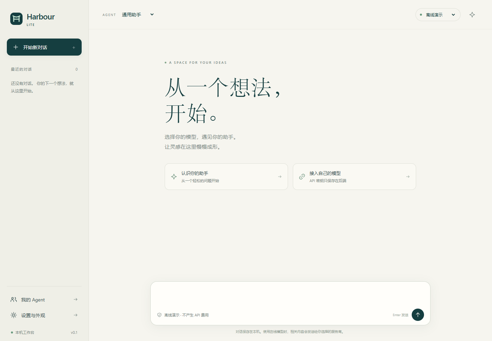
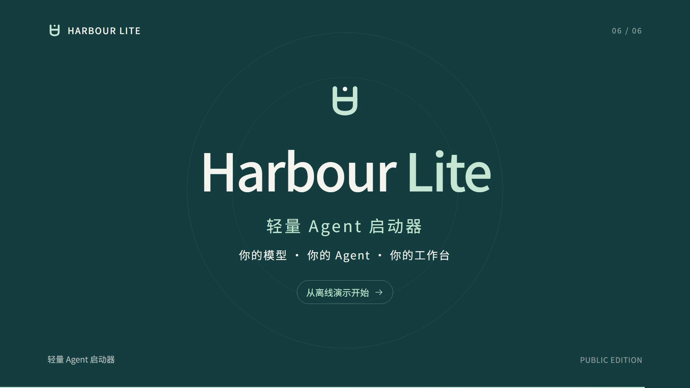
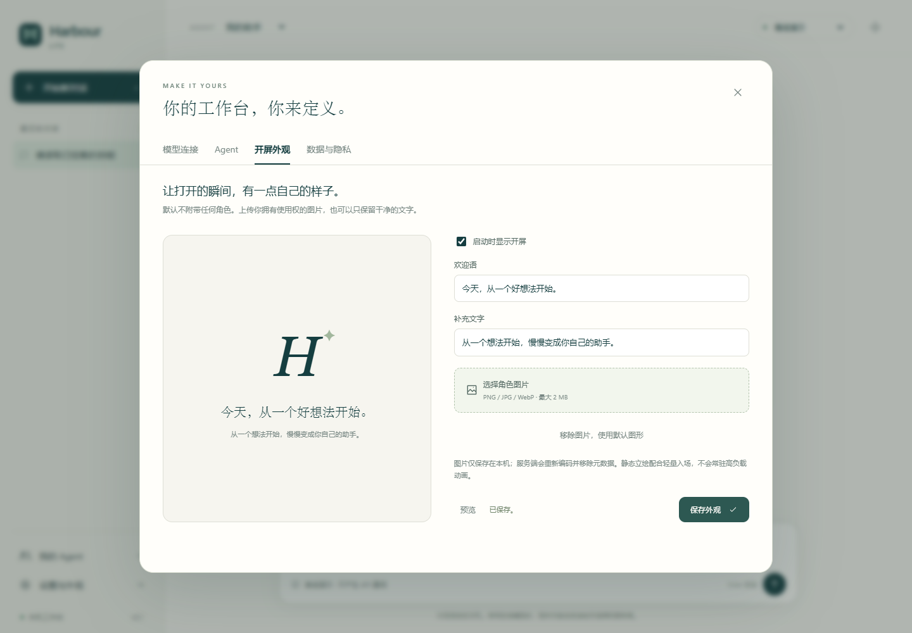

<div align="center">

# Harbour Lite

### 给 AI 一个自己的工作台。

你的模型 · 你的 Agent · 你的角色图片

[快速开始](#快速开始) · [自定义 Agent](#自定义-agent) · [开屏外观](#开屏外观) · [安全说明](SECURITY.md)

</div>



Harbour Lite 是一个本机优先的轻量 Agent 工作台。它提供干净的对话界面、模型连接、文件夹式 Agent 和按需读取的技能；你来决定助手是什么样子、使用什么模型、掌握哪些能力。

**先打开，再配置。** 默认离线演示，无需 API Key，不会发起付费模型请求。

## 30 秒了解它

[](docs/media/intro.mp4)

[▶ 播放 / 下载介绍视频](docs/media/intro.mp4) · [可编辑视频工程](demo/) · [视频复现与验收](demo/VIDEO-NOTES.md)

介绍视频由 Codex（GPT‑6 Astra，Max）配合 [Remotion 官方 Agent Skills](https://github.com/remotion-dev/skills) 制作，包含完整源码与已渲染 MP4。视频面板标注为「界面示意」，上方工作台图片才是实际运行截图。视频无音轨；如果 GitHub 当前页面不内嵌播放，打开 MP4 后选择下载或原始文件即可查看。

## 有什么

| 能力 | 这一版提供什么 |
| --- | --- |
| 模型连接 | OpenAI 兼容 Chat Completions、Anthropic Messages；自填模型 ID 和服务地址 |
| Agent | Markdown 指令、默认模型、回合上限、明确的技能挂载白名单 |
| 多会话 | 本机保存、切换、复制、删除；最多 4 个会话同时运行，同一会话串行 |
| 执行记录 | 显示模型回合、技能读取与停止原因；网页断开不自动取消后端任务 |
| 个性化 | 自选开屏角色图片、欢迎语、补充文字，也可关闭开屏 |
| 桌面窗口 | 可选 Electron 外壳；与浏览器版共用这份应用 |
| 轻量默认 | 两个中性 Agent、两个原创通用 Skill，无后台定时模型请求 |

这是一份**独立、重新整理的公开底座**，不是完整私人部署的镜像，也不继承它的 Git 历史。它不附带个人身份、记忆、偏好、聊天、账号、角色素材、成人内容或现成业务 Workflow。没有预置桌宠、语音、社交机器人、浏览器代操作、图像生成流水线或任意 Shell 工具。这些能力可以后续自行实现，不应把截图或演示理解成已经提供。

## 快速开始

需要 **Node.js 22.12+** 和 npm。Windows、macOS、Linux 的浏览器模式使用相同命令。

1. 使用 GitHub 的 **Code → Download ZIP** 下载并解压，或克隆本仓库。
2. 在项目目录打开终端：

```sh
npm ci
npm start
```

3. 浏览器打开 **http://127.0.0.1:7799**。
4. 点击「认识你的助手」，发送演示消息。输入“读取已挂载的技能”可以检查完整的技能读取链路。

首次 `npm ci` 需要联网下载依赖。启动后的演示本身完全离线，回复是固定演示内容，不是真实推理。

### 可选桌面窗口

```sh
npm ci --prefix desktop
npm run desktop
```

桌面端会启动自己的本机服务；如果端口 7799 已有 Harbour Lite，则复用它。关闭窗口只停止由该窗口启动的服务，不关闭外部启动的服务。端口被其他程序占用时会提示失败，不会强杀其他程序。

当前交付源码启动器，不包含 Windows 安装器或 macOS 签名安装包。Electron 是可选依赖，不使用桌面端就不必安装它。

安装桌面依赖后，可运行 `npm run test:desktop` 做隐藏窗口冒烟测试。它使用独立临时数据和空闲端口，不打开可见窗口。桌面自定义端口使用环境变量 `HARBOUR_LITE_DESKTOP_PORT`，默认仍为 7799。

## 连接模型

进入左下角 **设置与外观 → 模型连接 → 添加连接**：

1. **连接标识**：小写字母、数字和短横线，如 `my-model`。
2. **显示名称**：你希望在菜单里看到的名字。
3. **协议**：按服务商接口选择 OpenAI 兼容或 Anthropic。
4. **API 根地址**：OpenAI 兼容填到版本前缀，例如 `https://api.example.com/v1`，应用追加 `/chat/completions`；Anthropic 可填服务根或 `/v1`，应用调用 `/v1/messages`。
5. **模型 ID**：填写该端点实际提供的模型标识，不是界面昵称。
6. **API Key**：保存到项目本机 `.env`，界面不会回显。再次编辑留空保留原密钥。

保存不会自动调用模型。关闭设置，在对话顶部选择新模型，再发送消息才会请求。已有对话切换模型或 Agent 时会开始新会话，避免悄悄把旧对话发送到另一个服务商。

本地兼容服务允许使用 `http://127.0.0.1:端口/v1`，可以不填密钥；非本机地址必须使用 HTTPS。兼容协议不代表所有服务商的扩展参数都支持：当前不接入订阅登录、供应商专有推理参数、图片输入、实时语音或 Responses API。不能使用工具调用的模型，请在 Agent 设置中关闭 `read_skill`。

失败不会自动重试或换服务商。停止请求不能保证撤销已经发生的计费，具体以你的服务商为准。

## 自定义 Agent

最简单的方法是打开 **我的 Agent → 创建 Agent**，修改名字、指令、默认模型与技能，然后保存。

界面创建或修改的 Agent 位于 `data/agents/<id>/CLAUDE.md`，同名时覆盖仓库模板；**不会改动 `agents/` 中的公共示例**。本机修改默认被 Git 忽略。已经运行的任务使用启动时的配置快照，修改从下一次任务生效。

希望提供可分享模板时，可新建 `agents/my-assistant/CLAUDE.md`：

```markdown
---
name: 我的助手
description: 帮我整理想法，做清晰的计划。
model: demo
maxSteps: 8
skills:
  - task-planning
tools:
  - read_skill
---

你是一位清晰、可靠的助手。
先确认目标，再给出简洁可执行的建议。
只宣称实际完成的操作。遇到适用的技能时，按需读取。
```

目录名就是 Agent 标识。`model` 指向已配置连接的标识；分享模板建议保留 `demo`，让接收者自己选择模型。不要把真实姓名、密码、私人关系或长期记忆写进准备公开的模板。

## 增加技能

技能格式为 `skills/<id>/SKILL.md`。自己的私有技能建议放在 `data/skills/<id>/SKILL.md`，不会进入 Git；同名时本机版本优先。

```markdown
---
name: my-skill
description: 描述这项技能做什么、什么时候适用。
---

# 方法

这里写步骤、检查标准和必要的参考资料。
```

刷新 Agent 设置，在白名单里选择它。模型通常只看到已挂载技能的名称和简介，需要时才通过 `read_skill` 获取正文。参考资料限技能包内的 `.md`、`.txt`、`.json` 文本，单文件上限 64 KB；路径穿越、越界符号链接和未挂载技能会被拒绝。

Skill 是指导文档，不是提权入口。当前版本不会执行 Skill 中的脚本或 Shell 命令。扩展真实工具时请先阅读 [扩展设计](docs/EXTENDING.md)。

## 开屏外观

**设置与外观 → 开屏外观** 中可开启/关闭动画、修改欢迎语、选择自己的角色图片。

- PNG / JPEG / WebP，文件不超过 2 MB，宽高各不超过 4096。
- 图片重新编码为 WebP，去除原始元数据，保存在本机 `data/appearance/`。
- 使用轻量入场效果；系统设置减少动态效果时自动简化。
- 默认只显示原创字母图形，不捆绑第三方角色或照片。
- 上传后还需点击「保存外观」；只预览不会更改启动配置。



## 数据与安全

| 位置 | 内容 | 默认进入 Git？ |
| --- | --- | --- |
| `.env` | 服务端 API Key、可选工作台访问口令 | 否 |
| `data/models.json` | 模型连接，不包含 Key | 否 |
| `data/agents/`、`data/skills/` | 本机 Agent 修改、私人技能 | 否 |
| `data/sessions/`、`data/runs/` | 聊天与执行记录 | 否 |
| `data/appearance/` | 自定义角色图片 | 否 |
| `agents/`、`skills/` | 中性公共模板 | 是 |

**本机保存不等于离线推理。** 使用在线模型时，Agent 指令、相关历史、用户消息和实际读取的技能会发送给配置的服务商。开屏图片不会作为模型输入发送。运行过程不添加分析埋点；依赖安装及可选视频工具有各自网络行为与许可。

默认监听 `127.0.0.1`，不向局域网开放。这个面板是单用户工作台，不是多租户平台。同一台电脑上其他进程仍可能访问未设口令的本机服务。如需访问口令，复制 `.env.example` 为 `.env` 并设置 `HARBOUR_LITE_TOKEN`；即使仅本机使用也可以设置。

非回环地址绑定要求至少 24 字符的访问口令，远程使用还需要你配置 TLS、防火墙和访问控制；不要直接把开发服务暴露公网。详情见 [SECURITY.md](SECURITY.md)。

### 运行边界

- 默认最多 4 个并行会话，同一会话只运行一个任务。
- 每轮默认 8 次模型回合，可按 Agent 配置为 1–32；每次最多 8 个只读工具调用。
- 默认总等待上限 3 分钟，达到上限会停止，不会自动重试。
- 上下文发送最近最多 24 条消息、合计最多 48,000 字符；这是字符限额，不是精确 token 计量。更早的完整历史仍保存在本机。
- 不自动压缩、不后台总结、不保证任意服务商模型上下文都足够。较小模型可自行调整代码中的窗口。
- 服务重启时，未完成任务标记为中断，保留记录但不自动续跑；首次启动不迁移任何其他应用的数据。
- 删除会话会删除本机消息和相关执行记录；不会撤回已发送到供应商的数据。

## 项目结构

```text
src/                 服务端、模型适配、Agent 执行、受限技能读取
web/                 无前端构建步骤的界面
agents/              可分享的中性 Agent 模板
skills/              原创通用技能
data/                你的本机数据（忽略）
desktop/             可选 Electron 外壳，依赖独立
demo/                Remotion 视频工程，依赖独立
docs/media/          公开截图、海报和介绍视频
tests/               不调用付费服务的测试
```

## 开发与验证

```sh
npm run dev
npm run typecheck
npm test
npm run test:ui
npm run audit:public
npm run build
```

`test:ui` 使用独立无头浏览器和临时数据目录，不复用浏览器登录、不抢占现有窗口、不调用付费模型。需要安装 Chrome / Chromium；找不到时通过 `CHROMIUM_PATH` 指定浏览器可执行文件。自动化测试包括真实 HTTP 协议适配的本机模拟服务，不等于已经验证所有商业模型。

提交前运行 `audit:public`。它检查将被 Git 收录的文件、危险数据目录、常见凭据和个人路径；自动扫描不能替代人工审查。请不要强制添加 `.env`、`data/` 或私人图片。

更详细的说明：[扩展设计](docs/EXTENDING.md) · [发布检查](docs/RELEASING.md) · [贡献指南](CONTRIBUTING.md)

## 许可证与致谢

本项目原创代码、公共示例与原创媒体采用 [MIT](LICENSE)。第三方依赖遵循各自许可证，详见 [THIRD_PARTY_NOTICES.md](THIRD_PARTY_NOTICES.md)。尤其是可选 `demo/` 使用的 Remotion 有独立许可条件，不因本项目的 MIT 自动变成 MIT。

感谢 [Remotion](https://www.remotion.dev/) 与 [Agent Skills 开放规范](https://agentskills.io/specification)。本项目没有把未明确授权再分发的第三方 Skill 打包到仓库。
